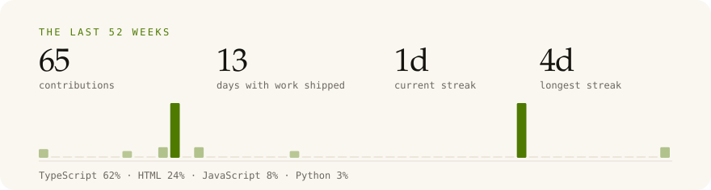

<picture>
  <source media="(prefers-color-scheme: dark)" srcset="assets/header-dark.svg">
  
</picture>

&nbsp;

I make products end to end — the app, the site, the backend, the store listing, and the
launch film. Mostly TypeScript, React Native and Next.js on Supabase, with some Swift when
iOS asks for it.

### Now shipping

<table>
  <tr>
    <td width="50%" valign="top">
      <b><a href="https://playrally.app">Rally</a></b> &nbsp;iOS · Android 
      The record of the people you actually play with. Score badminton, tennis, squash,
      table tennis, padel and pickleball; your opponent confirms the result; one rating per
      sport moves; your hostel, academy or Friday group gets its own board.  
      <code>React Native</code> <code>Expo</code> <code>Supabase</code> <code>Next.js</code>
    </td>
    <td width="50%" valign="top">
      <b><a href="https://allnighter.in">All Nighter</a></b> &nbsp;web · <a href="https://github.com/arykv/allnighter">source</a> 
      Everything you need at 11pm the night before. Every NCERT chapter for Class 10–12,
      handwritten notes, CBSE calculators and a checked directory of free resources, in one
      searchable place. Built by students, for students.  
      <code>TypeScript</code> <code>Next.js</code> <code>Vercel</code>
    </td>
  </tr>
</table>

### The year so far

<picture>
  <source media="(prefers-color-scheme: dark)" srcset="assets/pulse-dark.svg">
  
</picture>

<picture>
  <source media="(prefers-color-scheme: dark)" srcset="https://raw.githubusercontent.com/arykv/arykv/output/snake-dark.svg">
  
</picture>

### Lately

<!--ACTIVITY:START-->
- `2026-10-10` pushed commits to [allnighter](https://github.com/arykv/allnighter)
<!--ACTIVITY:END-->

&nbsp;

This page rebuilds itself every day from the GitHub API — <a href="scripts/build.mjs">scripts/build.mjs</a>.
