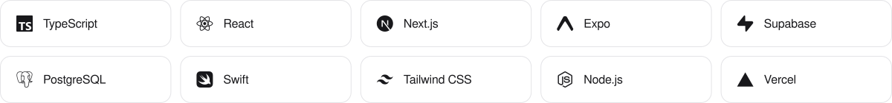
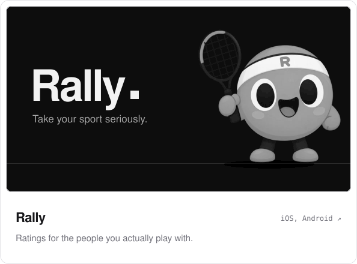
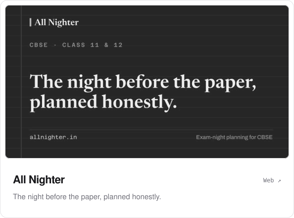

<picture>
  <source media="(prefers-color-scheme: dark)" srcset="assets/hero-dark.svg">
  
</picture>

  

  <picture>
    <source media="(prefers-color-scheme: dark)" srcset="assets/stack-dark.svg">
    
  </picture>

 

<a href="https://playrally.app"><picture><source media="(prefers-color-scheme: dark)" srcset="assets/rally-dark.svg"></picture></a>&nbsp;&nbsp;<a href="https://allnighter.in"><picture><source media="(prefers-color-scheme: dark)" srcset="assets/nighter-dark.svg"></picture></a>

 

<a href="https://arykv.github.io/arykv/">
  <picture>
    <source media="(prefers-color-scheme: dark)" srcset="https://raw.githubusercontent.com/arykv/arykv/output/snake-dark.svg">
    
  </picture>
</a>

<a href="https://arykv.github.io/arykv/">play it ↗</a>

