


<a href="https://playrally.app">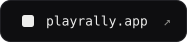</a>
<a href="https://allnighter.in">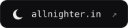</a>
<a href="https://arykv.github.io/arykv/">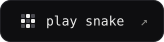</a>

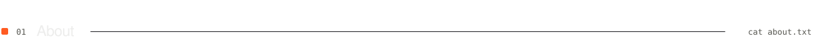


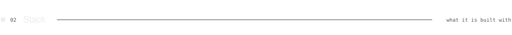

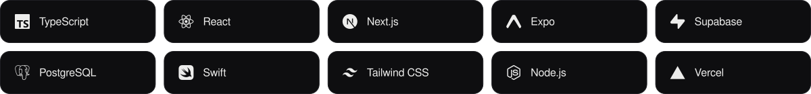

<a href="https://playrally.app">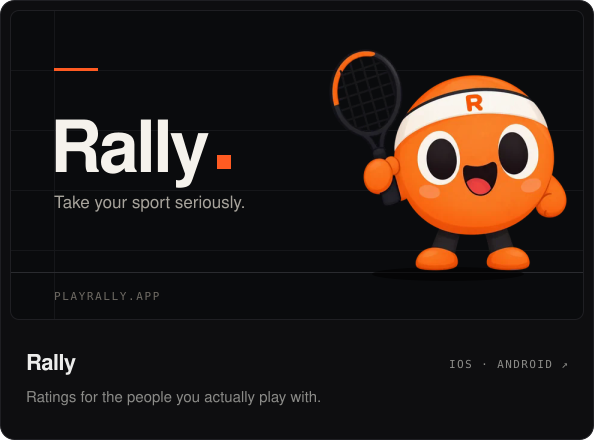</a>
<a href="https://allnighter.in">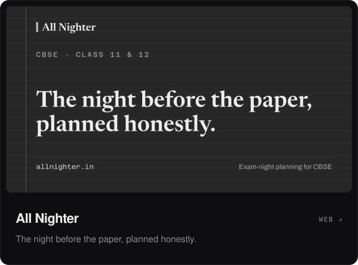</a>

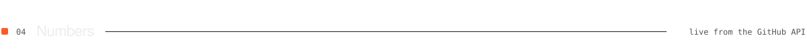

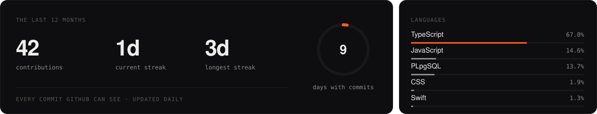

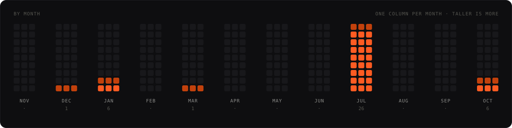

<a href="https://arykv.github.io/arykv/">
  <picture>
    <source media="(prefers-color-scheme: dark)" srcset="https://raw.githubusercontent.com/arykv/arykv/output/snake-dark.svg">
    
  </picture>
</a>

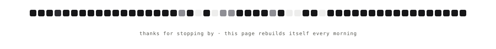

