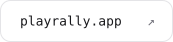
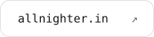
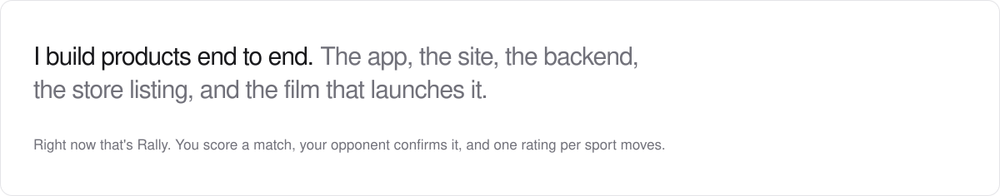
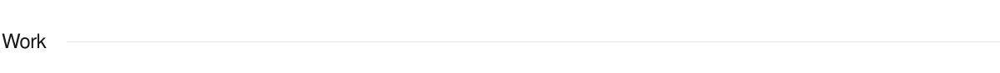
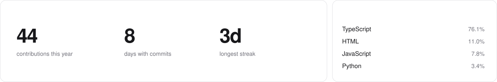
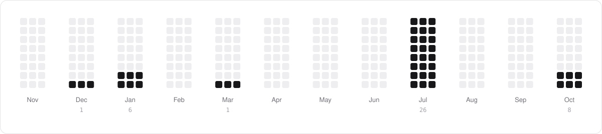

<picture><source media="(prefers-color-scheme: dark)" srcset="assets/hero-dark.svg"></picture>

<a href="https://playrally.app"><picture><source media="(prefers-color-scheme: dark)" srcset="assets/link-rally-dark.svg"></picture></a>
<a href="https://allnighter.in"><picture><source media="(prefers-color-scheme: dark)" srcset="assets/link-nighter-dark.svg"></picture></a>

<picture><source media="(prefers-color-scheme: dark)" srcset="assets/h-about-dark.svg"></picture>

<picture><source media="(prefers-color-scheme: dark)" srcset="assets/about-dark.svg"></picture>

<picture><source media="(prefers-color-scheme: dark)" srcset="assets/h-stack-dark.svg"></picture>

<picture><source media="(prefers-color-scheme: dark)" srcset="assets/stack-dark.svg"></picture>

<picture><source media="(prefers-color-scheme: dark)" srcset="assets/h-work-dark.svg"></picture>

<a href="https://playrally.app"><picture><source media="(prefers-color-scheme: dark)" srcset="assets/rally-dark.svg"></picture></a>
<a href="https://allnighter.in"><picture><source media="(prefers-color-scheme: dark)" srcset="assets/nighter-dark.svg"></picture></a>

<picture><source media="(prefers-color-scheme: dark)" srcset="assets/h-numbers-dark.svg"></picture>

<picture><source media="(prefers-color-scheme: dark)" srcset="assets/numbers-dark.svg"></picture>

<picture><source media="(prefers-color-scheme: dark)" srcset="assets/months-dark.svg"></picture>

<picture><source media="(prefers-color-scheme: dark)" srcset="assets/h-snake-dark.svg"></picture>

<a href="https://arykv.github.io/arykv/"><picture><source media="(prefers-color-scheme: dark)" srcset="https://raw.githubusercontent.com/arykv/arykv/output/snake-dark.svg"></picture></a>

<a href="https://arykv.github.io/arykv/">Play it</a>

<picture><source media="(prefers-color-scheme: dark)" srcset="assets/footer-dark.svg"></picture>

